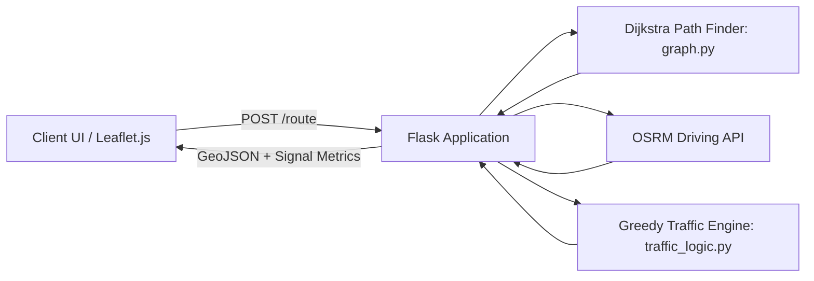

# 🚦 Smart Traffic Optimizer (Hadapsar, Pune)

[](https://www.python.org/)
[](https://flask.palletsprojects.com/)
[](https://networkx.org/)
[](https://leafletjs.com/)
[](#academic-context)

An intelligent urban traffic routing and signal management simulation system modeled around the **Hadapsar, Pune** corridor. Developed as a **Design and Analysis of Algorithms (DAA)** course project, the system combines **Dijkstra's Shortest Path Algorithm** with a **Greedy Dynamic Signal Scheduling Heuristic**, providing an interactive web-based simulation and comparative efficiency analytics against traditional fixed-timer traffic signals.

---

## 📌 Table of Contents
- [Problem Statement](#-problem-statement)
- [Key Features](#-key-features)
- [Algorithmic Framework](#-algorithmic-framework)
  - [1. Graph Representation](#1-graph-representation)
  - [2. Dijkstra's Shortest Path Algorithm](#2-dijkstras-shortest-path-algorithm)
  - [3. Greedy Dynamic Signal Scheduling](#3-greedy-dynamic-signal-scheduling)
  - [4. Delay & Efficiency Model](#4-delay--efficiency-model)
- [Architecture & Tech Stack](#-architecture--tech-stack)
- [Project Structure](#-project-structure)
- [Installation & Setup](#-installation--setup)
- [API Documentation](#-api-documentation)
- [How to Run & Simulate](#-how-to-run--simulate)
- [Academic Context](#-academic-context)

---

## 🛑 Problem Statement
Conventional traffic signal management relies predominantly on fixed-cycle timers that operate oblivious to real-time junction congestion. This leads to:
* Unnecessary vehicle idle times at empty intersections.
* Severe bottlenecking during peak rush hours.
* Increased commuter fuel consumption and carbon footprint.

The **Smart Traffic Optimizer** addresses this by modeling the road network as a weighted graph, calculating optimal travel paths, and dynamically allocating green-light durations to high-density approaches using a greedy prioritization strategy.

---

## 🌟 Key Features
- **Realistic Road Network Modeling:** Real-world GPS coordinates representing major Hadapsar junctions (Hadapsar Main, Gadital Chowk, Fatima Nagar, Magarpatta, Amanora).
- **Dual Routing Intelligence:**
  - **Graph Theory Layer:** Node-to-node shortest path computation via Dijkstra's algorithm.
  - **OSRM Polyline Integration:** Real-world street driving geometry fetched via the Open Source Routing Machine (OSRM) API.
- **Dynamic Signal Optimization:** A greedy algorithm prioritizes intersections and edges experiencing the highest traffic density.
- **Fixed vs. Dynamic Analytics:** Live side-by-side performance benchmarks (ETA, time saved, congestion load, and % efficiency improvement).
- **Interactive Visualization:** Responsive map powered by Leaflet.js with live vehicle animation, signal status indicators, and traffic heat coloring.

---

## 🧠 Algorithmic Framework

### 1. Graph Representation
The road network is modeled as an undirected, weighted graph $G = (V, E)$, where:
* **Vertices ($V$):** Major junctions and key intersections in Hadapsar, Pune.
  * `Hadapsar_Main` $(18.5088, 73.9250)$
  * `Gadital_Chowk` $(18.5015, 73.9384)$
  * `FatimaNagar_Junction` $(18.5097, 73.9018)$
  * `Magarpatta_Junction` $(18.5164, 73.9320)$
  * `Amanora_Entry` $(18.5186, 73.9365)$
* **Edges ($E$):** Road segments connecting adjacent junctions with weights ($w_e$) representing normalized travel cost / distance.

### 2. Dijkstra's Shortest Path Algorithm
* **Paradigm:** Greedy / Priority Queue based Single-Source Shortest Path.
* **Purpose:** Determine the minimum-cost route between the chosen origin and destination junctions.
* **Time Complexity:** $\mathcal{O}((V + E) \log V)$ using a binary min-heap / priority queue.
* **Space Complexity:** $\mathcal{O}(V + E)$.

### 3. Greedy Dynamic Signal Scheduling
* **Paradigm:** Greedy Heuristic.
* **Logic:** At each intersection $u \in V$, the system inspects all incident edges $(u, v) \in E$ and prioritizes the edge exhibiting the maximum traffic density:
  $$\text{Selected Edge } e^* = \arg\max_{e \in \text{Incident}(u)} \text{traffic}(e)$$
* **Adaptive Green Time Formulation:**
  $$\text{Green Time } (T_{\text{green}}) = T_{\text{base}} + (\text{traffic} \times 2)$$
  * $T_{\text{base}} = 5\text{ seconds}$ (guaranteed baseline clearance)
  * $\text{traffic} \in [1, 10]$ (simulated traffic congestion index)

### 4. Delay & Efficiency Model
For each edge $e$ in the traversed path:
* **Fixed Cycle Delay:** Statically modeled as $20\text{ seconds}$ per node.
* **Dynamic Delay:** Adaptively reduced based on green-light optimization:
  $$\text{Delay}_{\text{dynamic}} = \max(5, 20 - \text{congestion})$$
* **Percentage Efficiency Improvement:**
  $$\text{Efficiency } (\%) = \left(\frac{\text{Delay}_{\text{fixed}} - \text{Delay}_{\text{dynamic}}}{\text{Delay}_{\text{fixed}}}\right) \times 100$$

---

## 🛠 Architecture & Tech Stack



* **Backend:** Python 3, Flask
* **Graph & Algorithms:** NetworkX (Graph modeling and shortest path traversal)
* **GIS & Geocoding:** OSRM (Open Source Routing Machine) API
* **Frontend:** HTML5, CSS3, JavaScript (Vanilla ES6)
* **Mapping Engine:** Leaflet.js with OpenStreetMap tiles

---

## 📁 Project Structure

```text
smt_traffic/
├── .gitignore             # Git ignore patterns (virtualenv, pycache, OS junk)
├── README.md              # Project documentation and specifications
├── requirements.txt       # Python package dependencies
├── app.py                 # Flask server and routing controller
├── graph.py               # Graph representation, nodes, edges & Dijkstra algorithm
├── traffic_logic.py       # Greedy dynamic signal allocation & delay calculations
├── static/
│   ├── script.js          # Leaflet map rendering, animations, and frontend logic
│   └── style.css          # UI stylesheet and dashboard styling
└── templates/
    └── index.html         # Main dashboard interface
```

---

## 🚀 Installation & Setup

### Prerequisites
* Python 3.10 or higher installed
* `pip` package manager
* Active Internet connection (for Leaflet tiles & OSRM API)

### 1. Clone the Repository
```bash
git clone <your-repository-url>
cd smt_traffic
```

### 2. Set Up a Virtual Environment (Recommended)
On Windows (PowerShell):
```powershell
python -m venv venv
.\venv\Scripts\Activate.ps1
```

On macOS / Linux:
```bash
python3 -m venv venv
source venv/bin/activate
```

### 3. Install Dependencies
```bash
pip install -r requirements.txt
```

### 4. Run the Application
```bash
python app.py
```

The application will start on:
```text
http://127.0.0.1:5000/
```

---

## 📡 API Documentation

### `POST /route`
Calculates the optimal route, real-world polyline geometry, and dynamic signal states between two junctions.

#### Request Body (`application/json`)
```json
{
  "source": "Magarpatta_Junction",
  "destination": "Gadital_Chowk"
}
```

#### Valid Node Identifiers
* `Hadapsar_Main`
* `Gadital_Chowk`
* `FatimaNagar_Junction`
* `Magarpatta_Junction`
* `Amanora_Entry`

#### Sample Response (`200 OK`)
```json
{
  "path": ["Magarpatta_Junction", "Hadapsar_Main", "Gadital_Chowk"],
  "route": [[18.5164, 73.932], [18.5152, 73.9301], ...],
  "coords": {
    "Hadapsar_Main": [18.5088, 73.925],
    "Gadital_Chowk": [18.5015, 73.9384],
    ...
  },
  "signals": {
    "Hadapsar_Main": {
      "green": ["Hadapsar_Main", "Magarpatta_Junction"],
      "time": 19,
      "traffic": 7
    }
  },
  "comparison": {
    "fixed": 40,
    "dynamic": 26,
    "efficiency": 35.0
  },
  "metrics": {
    "signals": 5,
    "avg_delay": 14.0,
    "traffic_load": 5.8
  }
}
```

---

## 🎮 How to Run & Simulate
1. Open [http://127.0.0.1:5000](http://127.0.0.1:5000) in your web browser.
2. Select your desired **Source** and **Destination** junctions in the left sidebar.
3. Click **Load Route**:
   - Dijkstra's algorithm computes the graph path.
   - OSRM maps the real driving route onto the Leaflet map.
   - Traffic densities and signal states are generated.
4. Toggle between **Dynamic** and **Fixed** modes to observe latency differences.
5. Click **Start Simulation** to visualize vehicle traversal along the route.

---

## 🎓 Academic Context
* **Course:** Design and Analysis of Algorithms (DAA)
* **Institution:** Vellore Institute of Technology (VIT)
* **Semester:** Semester 5
* **Core Topics Demonstrated:**
  - Graph Algorithms (Shortest Path, Graph Modeling)
  - Greedy Algorithmic Paradigm (Local Optimum Heuristic for Signal Clearance)
  - Algorithmic Complexity Analysis ($\mathcal{O}$ notation)
  - Real-World Systems Simulation

